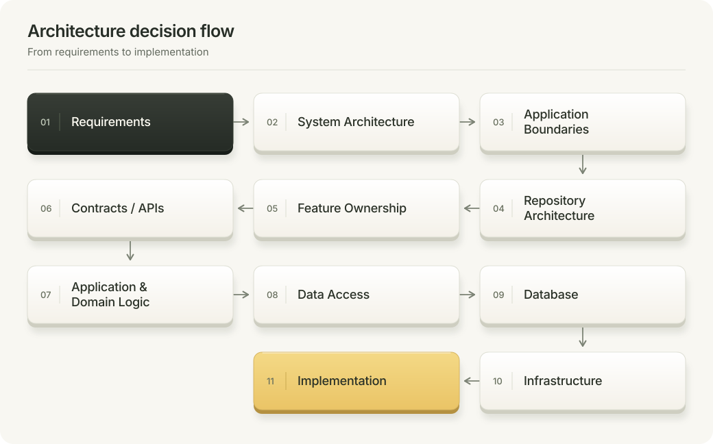
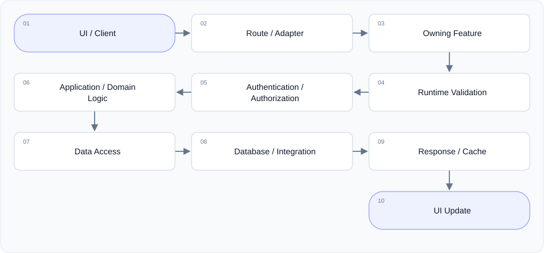
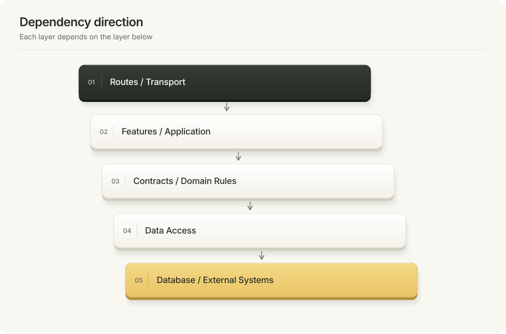

<div align="center">


# Vaastu — Scalable Software Architecture Skill

**An open-source, vendor-neutral software architecture skill and reusable playbook for AI coding agents.**

Turn product requirements into maintainable system boundaries, applications, features, contracts, backend operations, data access, persistence, shared packages, and infrastructure — **without blindly applying a fixed folder template.**

[](https://github.com/KOUSHIKG04/scalable-architecture-skill/blob/main/LICENSE)
[](https://github.com/KOUSHIKG04/scalable-architecture-skill/actions)
[](https://github.com/KOUSHIKG04/scalable-architecture-skill/pulls)

[Quick Start](#-quick-start) • [Core Idea](#-core-idea) • [What It Optimizes For](#-what-this-skill-optimizes-for) • [When to Use](#-when-to-use-it) • [Agent Usage](#-agent-usage) • [Dependency Model](#-important-dependency-model) • [Scaling Philosophy](#-scaling-philosophy)

</div>

---

## Read Vaastu with an AI agent

Vaastu is plain Markdown. Any agent that can read files can inspect [SKILL.md](skills/vaastu/SKILL.md) and follow its links to the relevant references, examples, and templates. Automatic discovery depends on the agent; provide the files directly when a native skill integration is unavailable. Agent behavior and production correctness still require review and verification.

## ⚡ Quick Start

Install from your project with the shared [Skills CLI](https://github.com/vercel-labs/skills), the same installer used by Vercel’s agent skills. The current Skills CLI requires Node.js 22.20 or later.

```bash
npx skills add KOUSHIKG04/scalable-architecture-skill --skill vaastu

# Other package runners
pnpm dlx skills add KOUSHIKG04/scalable-architecture-skill --skill vaastu
bunx skills add KOUSHIKG04/scalable-architecture-skill --skill vaastu

# Yarn 2+
yarn dlx skills add KOUSHIKG04/scalable-architecture-skill --skill vaastu
```

Yarn Classic (1.x) does not support `yarn dlx`; use the npm / npx command instead.

Choose the agents and installation method when prompted. Installation is project-local by default; add `-g` for a user-wide installation. The CLI manages agent-specific locations and links. For Codex, the project skill is available at `.agents/skills/vaastu/SKILL.md`.

```bash
# List available skills without installing
npx skills add KOUSHIKG04/scalable-architecture-skill --list

# Target Codex explicitly
npx skills add KOUSHIKG04/scalable-architecture-skill --skill vaastu -a codex

# Check and update installed skills
npx skills check
npx skills update
```

Review local edits before updating. Old `.architecture/` installations are not moved automatically.

Vaastu is a folder of instructions and resources, not a standalone installer. There is no `init` step. GitHub distribution through the Skills CLI does not require publishing Vaastu to npm. `package.json` is retained for development checks and optional archive distribution; it does not expose a custom executable.

---

## 💡 Core Idea

> **Architecture is a decision system, not a folder template.**


---

## 🎯 What This Skill Optimizes For

| Dimension | Architectural Goals |
| :--- | :--- |
| **Requirements & Boundaries** | • Requirement-driven architecture<br>• Clear application and deployment boundaries<br>• Feature-first organization |
| **Separation & Coupling** | • Thin route/framework adapters<br>• One-way dependency flow<br>• Controlled shared packages<br>• Platform-aware UI reuse |
| **Correctness & Security** | • Runtime validation and type safety<br>• Trusted authorization boundaries<br>• Database isolation |
| **Long-Term Evolution** | • Explicit state ownership<br>• Evolutionary scalability<br>• Machine-enforceable architecture rules |

---

## 🧭 When to Use **It**

<table width="100%">
<tr>
<th width="50%" align="left">💡 <b>TIP — When to Use</b></th>
<th width="50%" align="left">⚠️ <b>WARNING — When NOT to Use</b></th>
</tr>
<tr>
<td width="50%" valign="top">

• Starting a new product that may grow beyond one small app<br>
• Designing a TypeScript monorepo<br>
• Building web + mobile + admin/operations clients<br>
• Restructuring a codebase that has unclear ownership<br>
• Asking an AI coding agent to scaffold a scalable project<br>
• Defining architecture before feature implementation

</td>
<td width="50%" valign="top">

• Do <b>not</b> force a monorepo, microservices, repository layers, global state, or shared packages onto a project that does not need them.<br><br>
• Every architectural layer, package, and boundary must be justified by a real requirement.

</td>
</tr>
</table>

---

## 🤖 Agent Usage

For substantial architecture work, give your AI coding agent `SKILL.md` and the project requirements, then use the three-phase workflow below. For a focused task, use a short request and only the relevant guidance.

### Small project or focused change

One existing web application, browser-local persistence, and a single focused workflow. Use the short prompt and existing conventions; do not add a backend, workspace packages or an ADR unless the actual requirements justify them.

```text
Read .agents/skills/vaastu/SKILL.md and apply the relevant guidance to this existing web app.

Implement a personal expense tracker with add, edit and delete actions, a running total, and browser-local persistence. Reuse the current UI and project structure. No accounts, backend service or multi-app workspace are needed for this task.

Acceptance criteria: reject invalid or non-positive amounts; totals update after each change; saved expenses survive a page reload; existing routes and unrelated behavior remain intact.

Inspect the code, state a brief plan, and implement the scoped workflow. Verify the acceptance criteria with appropriate checks and report anything you could not exercise.
```

Expected approach: inspect the existing app, keep ownership local, implement one complete workflow, and verify it. A short plan is enough; no separate feature specification or full architecture proposal is required for this focused example.

### Large project or substantial build

Customer and operations experiences share durable order workflows with different permissions. Use the full-project template and documented requirements. Separate applications, packages and services only where the requirements justify the boundary.

```text
Read .agents/skills/vaastu/SKILL.md and REQUIREMENTS.md. Use the full-project implementation template and relevant supporting resources for this task.

Build the must-have scope in REQUIREMENTS.md for a multi-tenant order platform with customer and operations experiences. Customers create and view their own tenant’s orders. Authorized operations users update order status within their assigned tenant. Persist orders on the trusted backend and reject unauthorized or cross-tenant reads and writes.

Inspect the repository and present the simplest justified architecture and dependency-ordered plan before substantial edits. This request authorizes implementation of the documented must-have scope. Implement one connected create-order workflow first, verify it, and then complete the remaining dependency-ready must-have workflows.

Record significant decisions and relevant measurable requirements, with their sources and owners. Use feature acceptance criteria and the Definition of Done. Verify applicable contracts, permissions, data/retry behavior, dependencies and integrations. For a release, assess the relevant CI, migrations, recovery and operational checks.

Do not add speculative services or implement later features. Preserve existing behavior outside scope, and distinguish implemented, tested, deployed and operationally verified work. Report missing requirements or blocked integrations explicitly.
```

Before using this example, write REQUIREMENTS.md with the actual must-have workflows, roles, stack constraints, expected workload, relevant performance/recovery targets and release criteria. The full-project template supplies these fields. Unknown targets must remain explicit rather than being invented.

The short prompt remains the default. The full-project prompt adds context and delivery criteria for substantial work; it does not make every small change require a proposal, ADR, feature specification or new infrastructure. See the installed [small and large project examples](skills/vaastu/examples/using-vaastu.md) for the same workflow.

### Optional: architecture and full-project implementation

For a substantial build, use the [full-project implementation prompt](skills/vaastu/templates/PROJECT_IMPLEMENTATION_PROMPT.md). Fill in the project brief, in-scope workflows, and acceptance criteria, or reference your existing requirements. It carries the work through verified vertical slices while preserving existing behavior and the current conversation’s authorization.

The shorter proposal-first workflow below remains the default when you want to review architecture before implementation. A longer prompt is useful for more project context; it is not a certification or a guarantee of production readiness.

### Phase 1: Architecture Discovery & Proposal

Provide your agent with `SKILL.md` and your `REQUIREMENTS.md`.

```text
Read .agents/skills/vaastu/SKILL.md completely and treat it as the architecture decision framework for this project.

Read REQUIREMENTS.md.

Do not create or modify project files yet.

Produce:
- Requirement interpretation and measurable non-functional acceptance criteria
- Architecture decisions, trade-offs, and records for significant choices
- System architecture
- Application/deployment boundaries
- Repository tree
- Application and feature architecture
- Backend architecture
- Database architecture
- Shared package strategy
- Dependency rules
- Critical request/data flows
- Authentication and authorization strategy
- Environment/config strategy
- Testing strategy
- Scalability strategy
- Architecture guardrails
- Initial implementation plan

For every proposed application, package, service, global store, cache, queue, or architectural layer, state the concrete requirement that justifies it.

Remove unjustified abstractions.

Wait for architecture approval before scaffolding implementation.
```

---

### Phase 2: Architecture Approval & Vertical Slice Scaffolding

In this proposal-first workflow, once you review and approve the proposal, instruct the agent to scaffold. An existing architecture-and-implementation request does not require an additional approval just because the work uses these phases:

```text
Architecture approved.

Scaffold the project according to the approved architecture and SKILL.md.

Create only currently justified applications, packages, directories, and infrastructure.

Configure workspace tooling, TypeScript, linting, formatting, environment validation, tests, and architecture-boundary checks.

Do not implement every product feature.

Implement one minimal end-to-end vertical slice to prove the architecture.

Run typecheck, lint, tests, architecture checks, and build as applicable.
For a release, define the relevant CI, migration/recovery, and operational checks and report which were actually exercised.
```

---

### Phase 3: Vertical Feature Implementation & Continuous Architecture Validation

Deliver dependency-ready features as real workflows using the [feature delivery guide](skills/vaastu/references/feature-delivery.md).

1. Identify the user outcome, owning feature, acceptance criteria, edge cases, and existing behavior to preserve.
2. Define contracts, runtime validation, errors, permissions/resource scope, state, integrations and any data/transaction changes.
3. Implement a connected vertical slice across the boundaries that workflow actually needs. Integrate required services during the slice.
4. Run applicable behavior, contract, permission, integration, type/lint/build and dependency-boundary checks. Separate existing failures from regressions.
5. Review architectural impact. Record significant decisions with [ADRs](skills/vaastu/templates/ADR.md) or the project's equivalent; avoid unnecessary packages, state and infrastructure.
6. Verify acceptance using the Definition of Done: behavior and applicable controls/data changes work, checks have evidence, documentation is current, and limitations are explicit. Record passed, failed and unexecuted checks with their environment. Implementation, verified behavior, deployment and operational acceptance are different states.
7. Continue incrementally. Revisit decisions when requirements or measurements change; supersede accepted records without erasing history and preserve working behavior.

For substantial features, [FEATURE_SPEC.md](skills/vaastu/templates/FEATURE_SPEC.md) can capture the contract and evidence. Small changes do not need a separate specification. Use the [security/data checklist](skills/vaastu/references/security-checklist.md) for affected risks and [deployment readiness](skills/vaastu/references/deployment-readiness.md) for releases. These guides do not certify security or production readiness.



---

## Architecture failure prevention and repair

For the 14 architecture decisions, the [failure prevention and remediation guide](skills/vaastu/references/architecture-failure-remediation.md) explains how to detect a problem, prevent it, repair it within the task’s scope, and verify the result. Read the relevant sections when designing or changing a workflow. The guide helps an agent act on risks; it does not automatically fix a repository or certify production correctness.

---

## 📦 Toolkit Structure

```text
repository/
├── skills/
│   └── vaastu/
│       ├── SKILL.md                 # Name, description, concise workflow
│       ├── references/              # Detailed guidance loaded as needed
│       ├── templates/               # Requirements and proposal templates
│       ├── examples/                # Illustrative architectures
│       ├── scripts/
│       │   └── check-architecture.mjs # Adaptable boundary-check starter
│       └── LICENSE.txt
├── tests/                          # Maintainer checks, never installed
├── .github/workflows/              # Maintainer CI, never installed
├── assets/                         # Branding and portable README diagrams
├── tools/generate-readme-diagrams.mjs # Regenerate README SVGs
├── package.json                    # Development and optional archive metadata
├── README.md
└── LICENSE
```

---

## 📈 Scaling Philosophy

The skill distinguishes **four distinct kinds of scale**:

| Scale Dimension | Focus & Resolution |
| :--- | :--- |
| 🧩 **Codebase Scale** | Add features without turning `components/`, `utils/`, `services/`, or global state into dumping grounds. |
| 📱 **Application Scale** | Add new clients while keeping apps independent and moving only genuinely shared responsibilities into packages. |
| 👥 **Team Scale** | Make ownership visible so teams can work on separate features/apps without constant cross-module modification. |
| ⚙️ **Infrastructure Scale** | Begin with the simplest trusted backend and database topology, then introduce caching, queues, workers, realtime, or independent services only when measured requirements justify them. |

---

## 📐 Important Dependency Model



> [!IMPORTANT]
> - **Shared packages never depend on applications.**
> - **Applications never import another application's source.**

---

## 🏛️ Reference Philosophy

This toolkit was generalized from a real multi-application TypeScript architecture containing independently owned mobile/web applications, feature-oriented modules, shared design tokens, platform UI packages, contracts/data-access boundaries, and backend infrastructure.

The reference implementation is evidence for the principles, not a directory tree that new projects must clone.

---

## 📄 License

[MIT](./LICENSE) © [KOUSHIK G](https://github.com/KOUSHIKG04)

